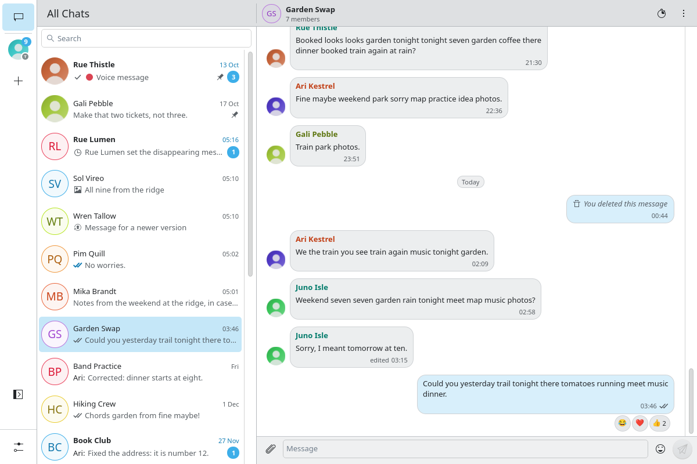
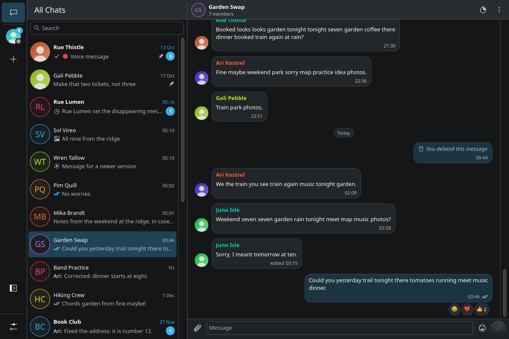
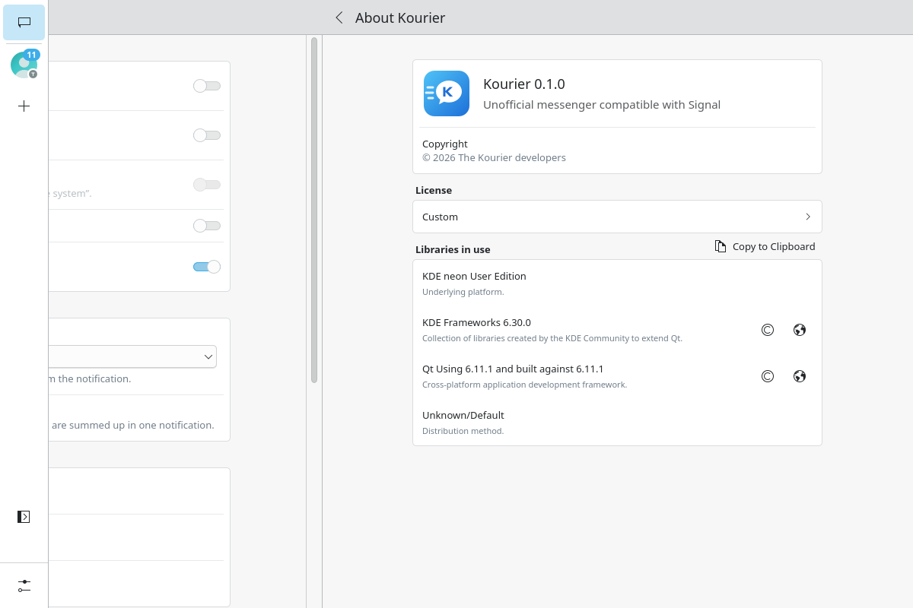

# Kourier

Kourier is an unofficial, independent desktop client compatible with
[Signal](https://signal.org), written in Rust with a Qt 6 and Kirigami interface for KDE Plasma on
Wayland. It links to your Signal account as a secondary device, the way Signal Desktop does.

**Kourier is not affiliated with or endorsed by Signal Messenger, LLC.** "Signal" is a trademark of
Signal Messenger, LLC. Kourier uses Signal's published client library (libsignal) and speaks
Signal's protocol; Signal does not support third-party clients, and a change on Signal's servers
can break Kourier without notice.

"Kourier" is a working name. It collides with other products, and the project will be renamed
before its first public release.

## Status

Pre-release, version 0.1.0. Nothing is released, packaged or published yet; you build it from source
(below). It has been exercised against Signal's own test server (`@signalapp/mock-server`) by the
automated suites in this repository, and in one scripted session against Signal's production
servers with a dedicated test account (2026-10-07). It has not had a security review. Do not rely
on it for anything you cannot afford to lose or leak.

## What works today

- Link as a secondary device by scanning a QR code with the Signal app on your phone; several
  accounts side by side.
- Contacts, groups and chat state (archived, pinned, muted, blocked) are read from your account.
  Kourier does not write them back: change those on the phone.
- Send and receive text in 1:1 chats and in groups, with delivery and read receipts and typing
  indicators.
- Replies with quotes, reactions, edits (with their history), delete for everyone and delete for
  me.
- Disappearing messages, including custom timers.
- Attachments: pictures, videos and files, received and sent. A send takes any number of files of
  any kind and splits them into the messages every Signal client shows in full. A folder can be
  added file by file or sent as one `.zip`. Videos and files open in the system's applications;
  there is no built-in video player.
- Long messages are shown in part, with "Read more".
- Desktop notifications, a single running instance per profile, light and dark Breeze color
  schemes.
- An encrypted local database (see the security model).

## What it is not

- Not a way to register with Signal: Kourier cannot create an account or a primary device, you
  need the Signal app on a phone.
- Not feature-complete: no calls, no stories, no payments, no group management (creating groups,
  inviting, admin actions), no profile editing, no message history transfer from the phone, no
  link previews.
- Not a multi-protocol messenger yet. The core is written so that other networks can be added
  as backends (Threema and WhatsApp are planned); only the Signal backend exists.
- Not packaged. There is no Flatpak, distribution package or installer yet.

## Security model

1. All message encryption, key handling and the connection to Signal's servers are done by
   libsignal, the library Signal's own clients use. Kourier adds the storage, the user interface
   and its own service layer around it.
2. At rest, the databases are SQLCipher files. The main database's key derives from a random master
   key kept in the desktop's Secret Service (or from a passphrase when none is available); each
   account's database has its own random key, stored wrapped under a key made from the master key
   and a per-account secret, so removing an account makes its database unreadable. Attachments are
   encrypted file by file. There is no plaintext fallback.
3. Plaintext files are rare and short-lived: media being played and pictures pasted into the
   composer live in the memory-backed `$XDG_RUNTIME_DIR`; a folder sent as one `.zip` is packed in
   your cache directory (mode 0600) and removed afterwards; a file you save is a plain file
   where you put it.
4. Everything from the network is treated as untrusted: size limits, pictures decoded only as a
   format Kourier identified itself, message markup generated from a whitelist, links opened only
   after a click.
5. No telemetry, no analytics, no update checks, and no server of Kourier's own: it talks to
   Signal's servers (see PRIVACY.md for how names are looked up). It does not protect you from
   malware running as your user, an unlocked keyring, or the metadata Signal's servers see.

Details: [PRIVACY.md](PRIVACY.md) and `docs/architecture.md` sections 5 and 9. Report a
vulnerability as described in [SECURITY.md](SECURITY.md).

## Build and run from source

Kourier is tested on one setup: KDE neon (Ubuntu 24.04) with Plasma 6 on Wayland, system Qt 6.11
and Kirigami 6.30. Other distributions are untested.

You need:

- Rust 1.99 (`rust-toolchain.toml` selects it through rustup).
- Qt 6.11 development files and `qmake6`, and these QML modules at run time: Qt Quick Controls,
  Kirigami, Kirigami Addons, the KDE desktop style (`qqc2-desktop-style`), KDE Prison (QR codes),
  KWindowSystem and KI18n. `.cargo/config.toml` sets `QMAKE=/usr/bin/qmake6`; edit it if your
  `qmake6` is elsewhere. Kirigami must be built for the same Qt as the one you build against.
- `protobuf-compiler`, `cmake`, `clang`, `perl`, `make`, `pkg-config` and `lld` (libsignal's
  BoringSSL and the Qt bindings build C and C++ code).
- Optional: the `QtMultimedia` QML module (loaded when audio is first played).
- Optional, for the tests of the Signal backend: Node.js 24 (see `tests/mock-harness/README.md`).

The package list above is what the author's machine has, not a minimal verified set; if a build
fails on a missing package, please say which in an issue.

```bash
cargo build --release -p kourier   # target/release/kourier
target/release/kourier             # on a Plasma Wayland session; the first start offers to link
```

A cold build takes about 15 minutes on six cores (the Qt bindings' C++ and libsignal take about
seven each) and a debug build directory grows to tens of gigabytes. Incremental builds take seconds.

To look at the interface without an account, run the real application on a temporary profile with a
scripted fake network and demo data:

```bash
target/release/kourier --fixture
```

Useful commands (`cargo xtask` is an alias set in `.cargo/config.toml`):

```bash
cargo xtask ci                        # format, clippy, crate-edge check, all tests, qmllint, screenshots
cargo xtask install --prefix <dir>    # binary, desktop entry, icon, metainfo into <dir>
cargo xtask uninstall --prefix <dir>
```

`cargo xtask install --user` registers Kourier for `sgnl://` and `signalcaptcha://` links unless
another application already claims them. Read [CONTRIBUTING.md](CONTRIBUTING.md) before running
anything against a real Signal account.

## Where the design is

`docs/architecture.md` is the design and the record of decisions. In short: a protocol-agnostic core
(`kourier-core`) owns the local database, the outbox and the timers; a backend crate
(`kourier-signal`) turns one network into the core's events and commands; `kourier-viewmodel` holds
what the interface shows without any toolkit; `kourier-qt` is the only crate that depends on Qt. A
front-end for another toolkit would be written against `kourier-viewmodel`; none exists.

## Screenshots

All pictures show the built-in demo data (`kourier --fixture`): the people, chats and messages are
made up.







## Contributing

Bug reports and patches are welcome. Read [CONTRIBUTING.md](CONTRIBUTING.md) (sign-off and test
rules), [CODE_OF_CONDUCT.md](CODE_OF_CONDUCT.md) and [GOVERNANCE.md](GOVERNANCE.md). Translating is
described in [TRANSLATING.md](TRANSLATING.md); there is no translation yet.

## AI use

Most of this code base was written by Claude Code (Anthropic's coding agent) under the direction
and review of the maintainer, and is tested by the suites in this repository. What that means, and
how it is checked, is in [AI-USE.md](AI-USE.md).

## License

AGPL-3.0-only, see [LICENSE](LICENSE). libsignal is AGPL-3.0-only, so Kourier is too, and
contributions come in under the same license. The project follows the
[REUSE](https://reuse.software) specification (`REUSE.toml`, `LICENSES/`). Licenses of the Rust
dependencies are collected by `cargo about` (`about.toml`); a release will ship that list.

## Acknowledgments

[libsignal](https://github.com/signalapp/libsignal) and Signal Desktop's protocol definitions, by
Signal Messenger, LLC; [cxx-qt](https://github.com/KDAB/cxx-qt) by KDAB; Qt and KDE Frameworks
(Kirigami, Breeze); SQLCipher through [rusqlite](https://github.com/rusqlite/rusqlite);
libsignal-service-rs and the Whisperfish, Flare and gurk projects, whose work on Signal clients
Kourier's design consulted.

## Privacy and accessibility

[PRIVACY.md](PRIVACY.md) says what Kourier stores and where it connects.
[ACCESSIBILITY.md](ACCESSIBILITY.md) says what works with a keyboard and a screen reader today,
and what has not been checked.
